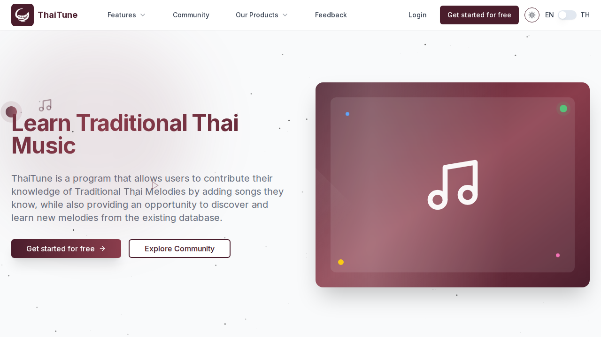

# ThaiTune - Traditional Thai Music Platform

[](https://github.com/Tarmk/Thai-Tune/actions/workflows/ci.yml)

[](LICENSE)

ThaiTune is a web platform dedicated to preserving, sharing, and exploring traditional Thai music. This application allows users to create, edit, and share musical scores, while connecting with a community of enthusiasts.

**Live:** https://thaitune.com



> This repository is the public copy of the ThaiTune code. The live site deploys from a private repository.

## Features

- **User Authentication**: Secure login with email/password and two-factor authentication
- **Personal Dashboard**: Create and manage your music scores
- **Score Editor**: Intuitive interface for composing traditional Thai music using Flat.io integration
- **Community**: Share your compositions and discover others' work
- **Multi-language Support**: Available in English and Thai
- **AI Assistant**: Get help with music theory and composition through the integrated chat
- **Admin Panel**: Manage users, feedback, and support tickets
- **Real-time Collaboration**: Live updates using Firestore

## Tech Stack

- **Frontend**: Next.js 15, React 19, TypeScript, Tailwind CSS
- **Backend**: Firebase (Authentication, Firestore, Cloud Functions)
- **State Management**: React Context API, useState/useEffect
- **Internationalization**: i18next
- **UI Components**: Radix UI, shadcn/ui
- **AI Integration**: OpenAI API
- **Music Editor**: Flat.io API integration

## Getting Started

### Prerequisites

- Node.js (v18 or later)
- npm or pnpm
- Firebase account

### Installation

1. Clone the repository:
   ```bash
   git clone https://github.com/Tarmk/Thai-Tune.git
   cd Thai-Tune
   ```

2. Install dependencies:
   ```bash
   npm install
   # or
   pnpm install
   ```

3. Set up environment variables:
   Copy `.env.example` to `.env.local` and fill in your configuration:
   ```bash
   cp .env.example .env.local
   ```

   Then update the values in `.env.local` with your actual credentials (Firebase web config, Flat.io key, OpenAI key, Resend key).

   📋 **For detailed setup instructions, see [docs/SETUP.md](docs/SETUP.md)**

4. Start the development server:
   ```bash
   npm run dev
   # or
   pnpm dev
   ```

5. Open [http://localhost:3000](http://localhost:3000) in your browser.

### Firebase Configuration

1. Create a Firebase project at [firebase.google.com](https://firebase.google.com)
2. Enable Authentication (Email/Password)
3. Create a Firestore database
4. Deploy Cloud Functions (located in the `functions` directory):
   ```bash
   firebase deploy --only functions
   ```

## Key Features & Technical Highlights

### Architecture
- **Modular Design**: Clean separation of concerns with feature-based modules
- **Type Safety**: Full TypeScript implementation with strict type checking
- **Responsive UI**: Mobile-first design with dark mode support
- **Real-time Updates**: Firestore listeners for live data synchronization

### Security
- **Authentication**: Firebase Auth with email/password and 2FA support
- **Authorization**: Role-based access control with Firestore security rules
- **Data Validation**: Client and server-side validation using Zod schemas

### Performance
- **Code Splitting**: Automatic route-based code splitting with Next.js
- **Image Optimization**: Next.js Image component for optimized asset delivery
- **Lazy Loading**: Dynamic imports for heavy components

## Project Structure

The project follows a modular architecture for better maintainability. See [docs/PROJECT_STRUCTURE.md](docs/PROJECT_STRUCTURE.md) for detailed information about the codebase organization.

```
├── app/                    # Next.js App Router
│   ├── (api)/              # API routes
│   ├── (auth)/             # Authentication pages
│   ├── (main)/             # Public pages
│   └── (protected-route)/  # Protected pages
├── components/             # Reusable React components
│   ├── auth/               # Authentication components
│   ├── common/             # Shared components
│   └── ui/                 # UI primitives (shadcn/ui)
├── modules/                # Feature modules
│   ├── dashboard/          # User dashboard
│   ├── new-score/          # Score creation
│   ├── community/         # Community features
│   └── admin/              # Admin panel
├── lib/                    # Utility libraries
│   ├── firebase.ts         # Firebase configuration
│   ├── flat/               # Flat.io API integration
│   └── openAI/             # OpenAI integration
├── functions/              # Firebase Cloud Functions
├── providers/              # React context providers
└── public/                 # Static assets
```

## Development

### Scripts

- `npm run dev`: Start development server
- `npm run build`: Build for production (type errors and lint errors fail the build)
- `npm run start`: Start production server
- `npm run lint`: Run ESLint
- `npm run typecheck`: Run the TypeScript compiler without emitting

CI runs lint, type-check and a production build on every push. More guides (email setup, the support inbox, logo assets) are in [`docs/`](docs/).

### Firebase Deployment

Deploy the entire application to Firebase:

```bash
npm run build
firebase deploy
```

## Troubleshooting

If you encounter build timeout issues, try increasing the timeout limit:

```bash
NEXT_DEBUG=true npm run build
```

## License

This project is licensed under the MIT License, see [LICENSE](LICENSE).

## Acknowledgments

- Thai traditional music community
- All open-source libraries and frameworks used in this project
